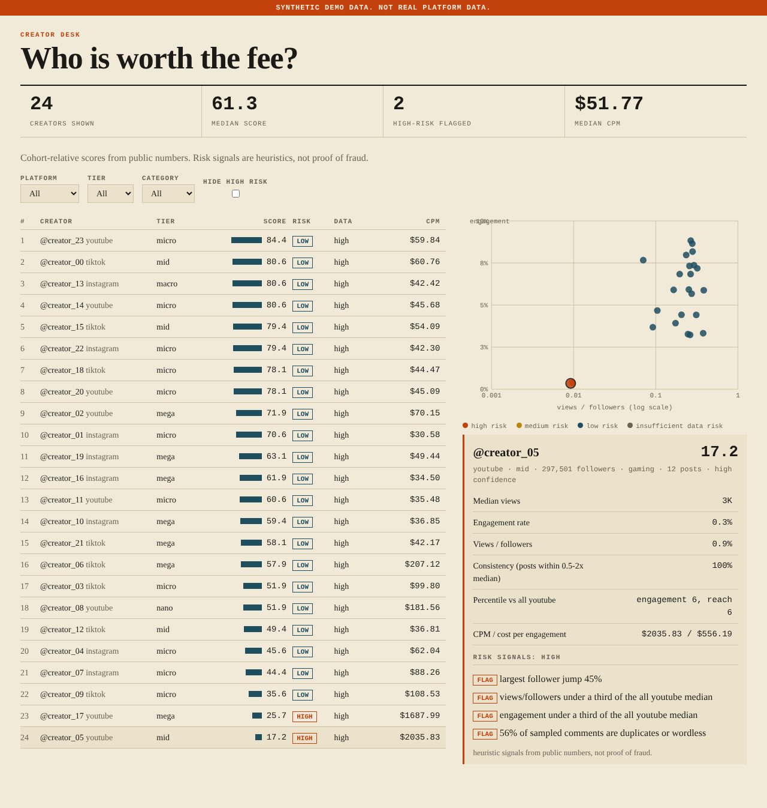
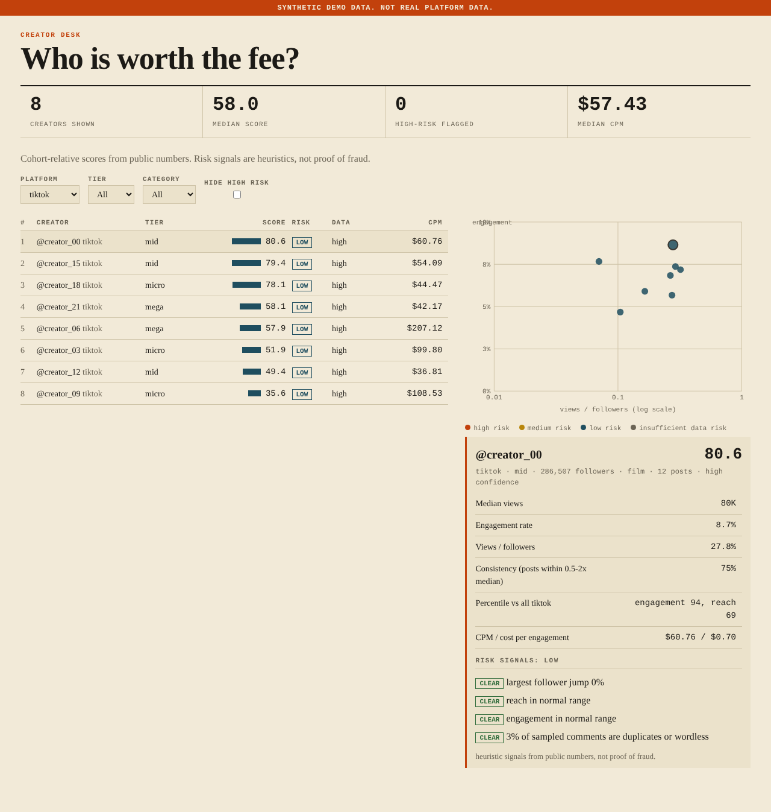
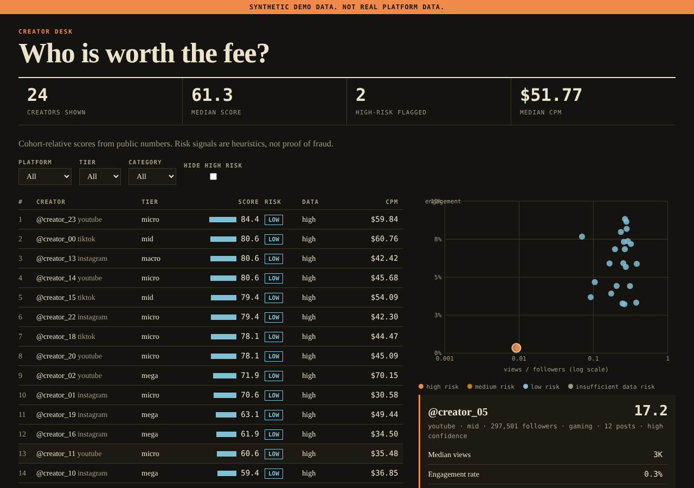
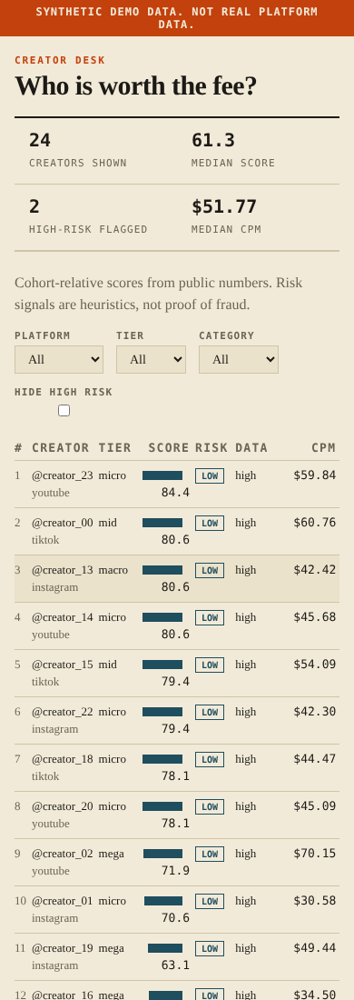
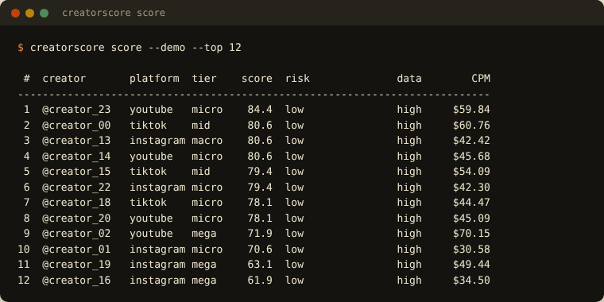

# CreatorScore: explainable creator quality scoring

**Who is worth the fee?** Ranks creators from public metrics against *your own cohort*, explains every score and every risk flag, and withholds a score rather than faking one when the comparison group is too small.

## Screenshots

> **About the screenshots.** All data shown is **synthetic** (the UI says so in an orange banner). Browser images are real captures of this project's own dashboard in Chromium; terminal images are the real stdout of each command, rendered into a terminal-styled page.

### Ranking, scatter and an explained high-risk creator


Ranked table (left); reach-vs-engagement scatter coloured by risk and the detail panel for `@creator_05` (right) listing all four flags with their evidence and the disclaimer: heuristic signals, not proof of fraud. (Two creators were built to look suspicious in the synthetic data.)

### Filtering


Platform filter applied; the figures strip and scatter follow the filter.

### Dark mode


Follows the system colour scheme.

### Mobile


Phone layout with a compact table.

### Terminal ranking


`score` prints the ranked table with the evidence for any flagged creator.

## What it does

- **Score 0-100** = `(0.4 x engagement percentile + 0.3 x reach percentile + 0.3 x consistency) x (1 - 0.5 x risk)`.
- **Cohort-relative**: percentiles are within the creator's platform + tier (nano < 10k < micro < 100k < mid < 500k < macro < 1M <= mega), falling back to the platform. **No industry benchmark is invented**, and with fewer than 5 comparable creators the score is **withheld** and raw metrics are shown instead.
- **Heuristic authenticity signals** (weights): follower spike 0.35, low reach 0.20, low engagement 0.15, duplicate or wordless comments 0.30. Reach/engagement flags require *both* the bottom decile *and* under a third of the cohort median, so the lowest creator in a small group is not flagged just for being lowest. Only evaluable signals count; with too little evidence the label is "insufficient data".
- **Cost efficiency**: CPM and cost per engagement from the creator's rate.
- **Explainable UI**: filters, a reach-vs-engagement scatter coloured by risk, and a detail panel listing every signal as *flag* or *clear*.
- **Privacy by design**: comment text is reduced to a single duplicate/wordless **ratio** at import; text and author identities are never stored.

## Quick start

```bash
pip install -e .
creatorscore serve --demo                              # dashboard on http://127.0.0.1:8000
creatorscore score --demo --top 12                     # ranked table in the terminal
creatorscore score --demo --categories film --format json
python -m unittest discover -s tests -v
```

## Using real data

```bash
creatorscore import-creators posts.csv --db creatorscore.db     # one row per post; see examples/creator_posts.template.csv
creatorscore import-followers history.csv --db creatorscore.db  # optional daily follower counts; see examples/followers.template.csv
creatorscore serve --db creatorscore.db
```
Rows that fail validation (zero followers, negative counters, bad dates) are rejected **with the line number and reason**. `sample_comments` is an optional `|`-separated column used only to compute the duplicate/wordless ratio.

Scoring definitions and weights: `docs/METHOD.md`.

## Status: what is verified and what is not

The build environment had **no network, no Postgres and no real API keys**. Everything below marked *not run* is code that exists and is unit-tested against local fakes, but has never talked to the real service.

| Area | Status |
|---|---|
| 7 tests: tiers, duplicate/wordless ratio, suspicious creators flagged and normal ones not (no false positives or mediums on the demo cohort), small-cohort score withheld, category ordering, CSV import with validation and normalisation, API hardening, real-browser filters + scatter + detail panel | **Pass** (`python -m unittest discover -s tests -v`) |
| Dashboard (light, dark, mobile) | Rendered and inspected in real Chromium; a browser test exercises filters, the scatter and the detail panel |
- Risk is a set of **heuristic signals from public numbers, not proof of fraud**; the API and UI say so on every record.
- Percentiles are relative to *your imported cohort*, so scores are comparable only within one cohort and one point in time.
- With few posts the stated confidence drops; with fewer than 5 comparable creators no score is produced.
- The weights (0.4/0.3/0.3, risk penalty 0.5) are judgement calls, documented in `docs/METHOD.md`; tune them to your campaign.
- No authentication on the dashboard.

## Known limitations

- **Not run on real data.** The demo cohort is synthetic and two creators were constructed to trip the signals, so the demo shows the logic works, not that the signals are accurate on real creators.

## Project layout

```
src/creatorscore/__init__.py
src/creatorscore/cli.py
src/creatorscore/creators.py
src/creatorscore/db.py
src/creatorscore/sample_data.py
src/creatorscore/schema.sql
src/creatorscore/stats.py
src/creatorscore/web.py
tests/__init__.py
tests/test_core.py
tests/test_delivery.py
docs/METHOD.md
examples/creator_posts.template.csv
examples/followers.template.csv
```

See `docs/PORTFOLIO.md` for resume bullets you can defend and the numbers you still need to measure yourself.

## Contributors

- **SriRamKunamsetty** ([@SriRamKunamsetty](https://github.com/SriRamKunamsetty)) - mohansriramkunamsetty@gmail.com
